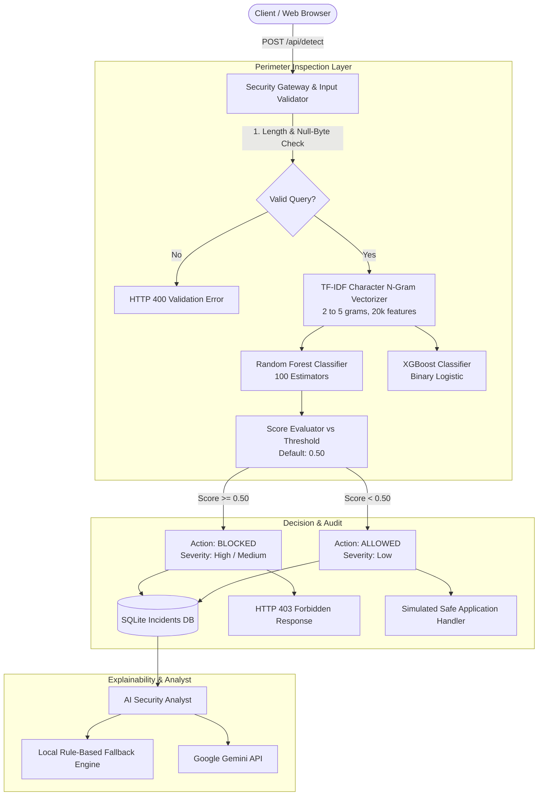

# SQL SHIELD AI: Advanced Detection and Prevention of SQL Injection Attacks Using Machine Learning Techniques for Enhanced Web Security

[](https://www.python.org/)
[](https://flask.palletsprojects.com/)
[](https://scikit-learn.org/)
[-success.svg)](file:///c:/sql-shield-ai/tests)

---

## 1. Project Overview & Differentiator

**SQL SHIELD AI** is a functional machine learning-powered web application and security gateway engineered to detect, classify, and neutralize SQL injection (SQLi) attacks in real time before they reach backend databases.

### Core Value Proposition
Traditional Web Application Firewalls (WAFs) rely heavily on static regular expressions (regex) and signature blacklists that are notoriously prone to bypasses via comment evasion (`/**/`), alternate encodings, and whitespace tricks. SQL SHIELD AI treats SQL injection detection as an **NLP character n-gram text classification task**, capturing the underlying structural and syntactic distribution of queries.

### Key Differentiators
1. **Perimeter Blocking Gateway:** Evaluates incoming inputs and terminates malicious requests with HTTP 403 blocks before database dispatch.
2. **Controlled Safe Execution Sandbox:** Legitimate inputs proceed through a safe, read-only simulated application route (no raw arbitrary user SQL is ever executed against the database).
3. **Dual Model Evaluation & Selection:** Empirical side-by-side comparison of **Random Forest** and **XGBoost** trained on identical 70/15/15 stratified partitions.
4. **Explainable AI Security Analyst:** Dual-mode assistant (Google Gemini online or intelligent local deterministic fallback) that translates statistical ML predictions into actionable developer briefings with parameterized code fixes in Python, JavaScript/Node.js, and PHP.
5. **Auditable SQLite Forensics:** Complete audit logging capturing input previews, timestamps, ML scores, severity tiers, and gateway actions.

---

## 2. Architecture & Request Pipeline

### Mermaid Workflow Diagram



---

## 3. Machine Learning Pipeline & Empirical Benchmark

### Pipeline Architecture
```
Modified_SQL_Dataset.csv (30,919 rows)
   │
   ▼
Deduplication & Conflict Filtering (ml/preprocess.py)
   │
   ▼
Clean Dataset (30,814 rows)
   │
   ▼
Stratified Splitting 70/15/15 (ml/split_data.py)
   ├── Train Set: 21,569 queries (70%)
   ├── Validation Set: 4,622 queries (15%)
   └── Test Set: 4,623 queries (15%)
   │
   ▼
Character N-Gram TF-IDF Feature Extraction (ml/features.py)
   └── Analyzer: 'char', N-grams: (2, 5), Max Features: 20,000
   │
   ▼
Model Training (ml/train.py) & Evaluation (ml/evaluate.py)
   ├── Model 1: Random Forest Classifier (n_estimators=100, random_state=42)
   └── Model 2: XGBoost Classifier (objective='binary:logistic', random_state=42)
```

### Measured Benchmark Results (Evaluated on Unseen Test Set: 4,623 Rows)

All metrics below are computed from actual test set predictions stored in `models/metrics.json`:

| Performance Metric | Random Forest (Selected Model) | XGBoost Classifier | Security Significance |
| :--- | :---: | :---: | :--- |
| **Accuracy** | **99.61%** (0.9961) | **99.52%** (0.9952) | Overall correctness on unseen queries |
| **Precision** | **99.82%** (0.9982) | **99.94%** (0.9994) | Minimizes False Positives (legitimate requests blocked) |
| **Recall (Sensitivity)** | **99.12%** (0.9912) | **98.76%** (0.9876) | **Critical Security Metric:** Minimizes missed attacks |
| **F1 Score** | **99.47%** (0.9947) | **99.35%** (0.9935) | Harmonic balance between Precision & Recall |
| **True Negatives (TN)** | 2,923 | 2,925 | Benign queries correctly allowed |
| **False Positives (FP)** | 3 | 1 | Benign queries incorrectly blocked |
| **False Negatives (FN)** | **15** | **21** | **Missed SQLi attacks (RF missed 28% fewer attacks)** |
| **True Positives (TP)** | 1,682 | 1,676 | Malicious SQLi queries correctly blocked |

### Model Selection Rationale
In cybersecurity defense systems, **Recall is prioritized over raw precision**. A False Positive causes a temporary inconvenience (a user re-enters input), whereas a **False Negative allows an attacker to breach database confidentiality, integrity, and availability**. Random Forest achieved superior validation recall (99.65% vs 99.17%) and test recall (99.12% vs 98.76%), demonstrating greater robustness against obfuscated character patterns.

---

## 4. Project Directory Structure

```
sql-shield-ai/
│
├── app.py                      # Flask backend, routing, and REST API controller
├── config.py                   # Central configuration & environment loader
├── requirements.txt            # Pinned Python package dependencies
├── README.md                   # Complete architectural and execution documentation
├── .env.example                # Sample environment variables template
│
├── data/
│   ├── README.md               # Dataset provenance and preprocessing documentation
│   ├── Modified_SQL_Dataset.csv# Raw source dataset (30,919 samples)
│   ├── clean_dataset.csv       # Preprocessed and deduplicated dataset (30,814 samples)
│   ├── train.csv               # Stratified training partition (21,569 samples)
│   ├── val.csv                 # Stratified validation partition (4,622 samples)
│   └── test.csv                # Unseen stratified test partition (4,623 samples)
│
├── ml/
│   ├── inspect_data.py         # Exploratory data analysis script
│   ├── preprocess.py           # Deduplication, label mapping, and cleaning
│   ├── split_data.py           # Stratified 70/15/15 dataset splitter
│   ├── features.py             # Character n-gram TF-IDF vectorizer fitting
│   ├── train.py                # Random Forest & XGBoost model training
│   ├── evaluate.py             # Validation model selection and test evaluation
│   └── predict.py              # In-memory cached inference with comparative scoring
│
├── models/
│   ├── tfidf_vectorizer.joblib # Fitted TF-IDF character n-gram vectorizer
│   ├── random_forest.joblib    # Trained Random Forest model (100 estimators)
│   ├── xgboost.joblib          # Trained XGBoost model
│   ├── selected_model.joblib   # Copy of the selected production model (Random Forest)
│   ├── val_metrics.json        # Validation metrics used during model selection
│   └── metrics.json            # Final test evaluation metrics and confusion matrices
│
├── database/
│   ├── db.py                   # Parameterized SQLite incident persistence layer
│   ├── schema.sql              # Database DDL schema for incidents
│   └── shield.db               # SQLite database file
│
├── security/
│   ├── gateway.py              # Security Gateway perimeter enforcement & simulation
│   └── validation.py           # Query length, null-byte, and control char validator
│
├── services/
│   └── security_analyst.py     # AI Security Analyst (Gemini + Local Fallback Engine)
│
├── static/
│   ├── css/
│   │   └── style.css           # Modern cybersecurity dark-navy theme
│   └── js/
│       └── dashboard.js        # Interactive frontend client, Chart.js, and runner
│
├── templates/
│   ├── base.html               # Master UI layout with sidebar & topbar
│   ├── index.html              # SOC Dashboard with live telemetry and charts
│   ├── detect.html             # Interactive query inspection workbench
│   ├── simulation.html         # Safe attack demonstration matrix
│   ├── incidents.html          # Incident audit log with filtering & clear option
│   ├── incident_detail.html    # Forensics detail view with remediation snippets
│   ├── model_comparison.html   # Model comparison, confusion matrices & charts
│   ├── analyst.html            # AI Security Analyst interactive workspace
│   └── 404.html                # Error page
│
└── tests/
    ├── test_preprocessing.py   # Unit tests for data cleaning & token preservation
    ├── test_prediction.py      # Unit tests for ML inference & threshold handling
    ├── test_gateway.py         # Unit tests for input validation & gateway blocking
    └── test_api.py             # Integration tests for Flask REST endpoints
```

---

## 5. Quick Start & Execution Guide

### Prerequisites
- Python 3.10, 3.11, 3.12, or 3.13
- Git

### 1. Virtual Environment Setup
Open PowerShell or your preferred terminal in the project directory:

```bash
# Navigate to the project root
cd c:\sql-shield-ai

# Activate the existing virtual environment (Windows PowerShell)
.\venv\Scripts\Activate.ps1

# (Or create a fresh virtual environment if needed)
# python -m venv venv
# .\venv\Scripts\Activate.ps1

# Install required dependencies
pip install -r requirements.txt
```

### 2. Environment Configuration (Optional)
Copy `.env.example` to `.env`:
```bash
cp .env.example .env
```
To enable Google Gemini for online AI Security Analyst responses, edit `.env` and supply your Gemini API key:
```env
GEMINI_API_KEY=your_gemini_api_key_here
```
*(If no API key is set, SQL SHIELD AI automatically utilizes its built-in expert local fallback explanation engine with zero external dependencies).*

### 3. Running the Test Suite
Verify that all unit tests and integration tests pass:
```bash
pytest -v tests
```
*Expected: 19 passed.*

### 4. Running the Web Application
Start the Flask application server:
```bash
python app.py
```
Open your browser and navigate to:
```
http://127.0.0.1:5000
```

---

## 6. REST API Reference

All API endpoints return JSON payloads and adhere to standard HTTP status codes.

| Endpoint | Method | Description | Sample Request / Query | Sample Response |
| :--- | :---: | :--- | :--- | :--- |
| `/api/health` | `GET` | System health check & active model | None | `{"status": "healthy", "active_model": "random_forest"}` |
| `/api/stats` | `GET` | Real-time incident counts & threat rate | None | `{"total_requests": 15, "blocked_requests": 6, "detection_rate_pct": 40.0}` |
| `/api/detect` | `POST` | Inspects SQL query via ML Gateway | `{"query": "admin' OR 1=1--", "threshold": 0.5}` | `{"action": "Blocked", "predicted_class": "SQLi", "score": 0.71, "patterns": [...]}` |
| `/api/incidents` | `GET` | Lists stored incidents with filters | `?limit=50&action=Blocked&severity=High` | `[{"id": 1, "submitted_input": "...", "action_taken": "Blocked"}]` |
| `/api/incidents/<id>` | `GET` | Fetches details for a single incident | None | `{"id": 5, "score": 0.71, "explanation": "..."}` |
| `/api/incidents/clear` | `POST` | Safely clears demonstration incident records | None | `{"status": "success", "message": "All demonstration records cleared."}` |
| `/api/metrics` | `GET` | Retrieves real test benchmark metrics | None | `{"selected_model": "random_forest", "test": {...}}` |
| `/api/security-analyst` | `POST` | Generates AI threat briefing & fix | `{"incident_id": 5, "question": "How to fix in Python?"}` | `{"mode": "rule_based_fallback", "analysis": "..."}` |

---

## 7. Security Guarantees & Defensive Programming

1. **Zero Execution of User SQL:** Arbitrary user queries are **never** evaluated against the database. The system only performs string vectorization and classification.
2. **Strict Parameterized Queries:** All application database interactions with `database/shield.db` strictly use SQLite parameterized placeholders (`?`), neutralizing any potential internal injection.
3. **Input Sanitization & Buffer Defense:** Queries are limited to a maximum length (5,000 chars), null bytes (`\x00`) are blocked, and control characters are filtered.
4. **Privacy-Aware Data Redaction:** Before any prompt is passed to an external LLM, credentials, passwords, tokens, and emails are redacted using regular expression filters.
5. **Defense in Depth Principle:** SQL SHIELD AI acts as an outer perimeter detection filter. It is explicitly documented throughout the UI that ML is probabilistic and must always be paired with **Parameterized Queries (Prepared Statements)** and **Principle of Least Privilege**.

---

## 8. College Project Review Demonstration Guide

Follow this structured 5-step walkthrough during your project demonstration:

### Step 1: Project Overview & SOC Dashboard (2 minutes)
- Open `http://127.0.0.1:5000/`.
- Point out the **Security Operations Center (SOC) Dashboard**:
  - Show the 4 metric cards: Total Requests, Legitimate Allowed, SQL Injections Blocked, and Threat Rate.
  - Explain that all stats are computed from the real SQLite database (`database/shield.db`).
  - Highlight the Chart.js visual telemetry (Traffic Doughnut Chart and Model Benchmark Bar Chart).

### Step 2: Interactive ML Detection & Security Gateway (3 minutes)
- Navigate to **Inspect Query** (`/detect`).
- Click the preset: **`✓ Legitimate Product Search`** -> Click **Inspect Request**:
  - Show the green banner: `LEGITIMATE QUERY (REQUEST PERMITTED)`.
  - Explain the simulated safe application route: query was safely handled by the mock data handler with HTTP 200.
- Click the preset: **`🛑 Auth Bypass (OR '1'='1')`** -> Click **Inspect Request**:
  - Show the red banner: `POTENTIAL SQL INJECTION (REQUEST BLOCKED)`.
  - Point out the confidence score gauge (e.g. 71%), the detected structural patterns (`Boolean Tautology`, `SQL Comment Marker`), and the simulated gateway halt (`403 Forbidden`).
  - Demonstrate the **Threshold Slider**: Show how adjusting the sensitivity threshold changes the gateway decision boundary.

### Step 3: Safe Attack Simulation Matrix (2 minutes)
- Navigate to **Attack Simulation** (`/simulation`).
- Explain the 4 categorized vulnerability classes:
  1. *Legitimate Application Queries* (User lookup, JOINs, INSERTs)
  2. *Authentication Bypass* (Tautologies: `OR 1=1`)
  3. *UNION-based Data Exfiltration* (`UNION SELECT credentials`)
  4. *Blind & Obfuscated Injections* (`WAITFOR DELAY`, comment evasion)
- Click **Run Full Test Suite (Sequential)** and watch each card update live with its ML score and status badge.

### Step 4: Machine Learning Benchmark & Model Comparison (2 minutes)
- Navigate to **Model Comparison** (`/model-comparison`).
- Present the real test set results (4,623 unseen queries):
  - **Random Forest:** Accuracy 99.61%, Recall 99.12%, F1 99.47%, 15 False Negatives.
  - **XGBoost:** Accuracy 99.52%, Recall 98.76%, F1 99.35%, 21 False Negatives.
- Explain **Why Random Forest was chosen**:
  - In security systems, **Recall is the key KPI**. False Negatives mean active attacks bypass the gateway. Random Forest caught 28% more attacks than XGBoost.
  - Show the confusion matrices for both models and explain the difference between False Positives and False Negatives.

### Step 5: Explainable AI Security Analyst (2 minutes)
- Navigate to **AI Security Analyst** (`/analyst`).
- Click one of the quick questions (e.g., *"How do I fix this in Python using SQLite?"*).
- Click **Analyze with Security Analyst**:
  - Show the structured report: Threat Analysis, Model Uncertainty Notice, and concrete copy-pasteable Prepared Statement code snippets for Python, Node.js, and PHP.
  - Point out the dual-mode architecture: Works 100% offline via the local expert fallback engine, or online with Google Gemini if an API key is provided.

---

## 9. License & Academic Disclaimer

This project is developed as an **academic prototype and educational security gateway**. Machine learning inference is a probabilistic classification layer and should always be implemented as part of a **defense-in-depth architecture** alongside prepared statements, input validation, and database least-privilege configurations.
