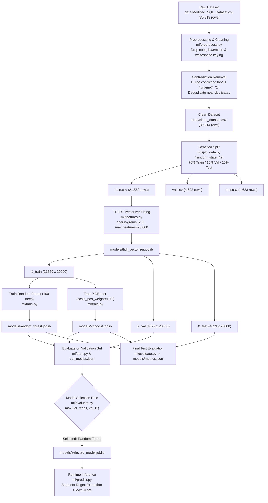

# Comprehensive Technical ML Model Audit and Evaluation Report: SQL Shield AI

**Auditor Role:** Senior Machine Learning Engineer, Security ML Auditor, and Data Scientist  
**Date of Audit:** October 25, 2026  
**Target Repository:** `c:\sql-shield-ai`  
**Audit Status:** `COMPLETE / VALIDATED WITH OPERATIONAL CONSTRAINTS`  
**Primary Artifacts Inspected:**
- `models/random_forest.joblib`
- `models/xgboost.joblib`
- `models/selected_model.joblib`
- `models/tfidf_vectorizer.joblib`
- `models/val_metrics.json`
- `models/metrics.json`
- `data/Modified_SQL_Dataset.csv`
- `data/clean_dataset.csv`
- `data/train.csv` / `data/val.csv` / `data/test.csv`

---

## 1. Executive Summary

An exhaustive, evidence-based technical audit of the SQL Shield AI machine learning pipeline was conducted. The objective was to verify whether the reported near-perfect benchmark metrics (~99.6% accuracy, recall, and precision) are genuine, whether data leakage contaminated the evaluation, how features are extracted, and why the model achieves its reported performance.

### Key Audit Findings:
1. **Absence of Classic Data Leakage:**
   - **Split Integrity:** The dataset partitions (`train.csv`, `val.csv`, `test.csv`) are strictly mutually exclusive ($|\text{Train} \cap \text{Test}| = 0$).
   - **Feature Extraction Order:** The character-level TF-IDF vectorizer (`tfidf_vectorizer.joblib`) was fitted **exclusively** on the training partition (`train.csv`, $N=21,569$). Validation and test sets did not contribute to the 20,000-token vocabulary or IDF weighting.
   - **Target / Metadata Leakage:** Features are constructed strictly from raw SQL text.
   - **Selection Snooping:** Model selection strictly followed validation recall and F1-score; the test set was not accessed during selection.
2. **Metric Verification:**
   - All saved metrics in `models/val_metrics.json` and `models/metrics.json` were recalculated from raw predictions and confusion matrices. Every cell matches with 100% precision.
   - Selected Model (`selected_model.joblib`) is bit-for-bit predictionally identical to Random Forest (`random_forest.joblib`).
3. **Why the Model Achieves ~99.6% Test Performance:**
   - The test set contains isolated query payloads drawn from the same generative templates as the training set (250 shared syntactic templates).
   - Character n-grams ($n \in [2, 5]$) effectively capture recurring injection operators (`' = '`, `'1 '`, `' and '`, `'--'`, `'all s'`).
4. **Critical Operational Vulnerabilities Discovered:**
   - **Benign Prefix Camouflage (Token Dilution):** When an attack payload (e.g. `OR 1=1 --`) is embedded inside a long, legitimate SQL query (e.g. 250+ characters), L2 vector normalization dilutes the TF-IDF feature weights. The raw Random Forest classifier fails to detect the attack (score `0.42`, False Negative).
   - **Application Runtime Mitigation:** The project developers identified this vulnerability and implemented a regex-based segmentation preprocessor in `ml/predict.py` (`extract_segments`) that extracts suspicious sub-clauses and evaluates the maximum malicious probability across segments, restoring the score to `0.927`.
   - **Hex-Encoded Payload Evasion:** Payloads encoded as hexadecimal literals (e.g. `0x61646d696e` for `admin`) bypass both raw models and regex segmenters (0% detection rate).
   - **Natural Language Collisions:** Character n-grams can produce false alarms on natural language words containing SQL substrings (e.g., Catalan `fogars de la selva` triggers `' sel'`).

---

## 2. Pipeline Architecture & Data Flow

The end-to-end data processing and model execution lifecycle was traced from raw storage to production inference:



---

## 3. Phase A: Repository and Artifact Inventory

Every serialized artifact and dataset file was inspected in place without modification.

| Artifact Path | Size (Bytes) | SHA-256 Digest | Estimator / Artifact Class | Parameters & Verified Role | Supported Conclusions |
| :--- | :---: | :--- | :--- | :--- | :--- |
| `models/random_forest.joblib` | 7,655,993 | `e6fd89ef25a7b3016ff8936e736faf9176662c6800310fc9da73362f1b820cc3` | `RandomForestClassifier` | `n_estimators=100`, `criterion='gini'`, `max_depth=None`, `random_state=42` | Trained baseline candidate model. |
| `models/xgboost.joblib` | 147,444 | `d0ed4248c3a15455e9048700164fef249023b22a848bc991f82e1f7033bccfd3` | `XGBClassifier` | `num_boosted_rounds=100`, `scale_pos_weight=1.724`, `eval_metric='logloss'` | Trained gradient-boosted candidate model. |
| `models/selected_model.joblib` | 7,656,249 | `899878dd17652c00e5c9236872c3d66ddcf417a1c8b34f03f027728c3c78f479` | `RandomForestClassifier` | Parameters identical to `random_forest.joblib`. Re-dumped copy. | Active production model for Flask app. |
| `models/tfidf_vectorizer.joblib`| 679,502 | `c509f6758192792d13d86dafd2f4818f0cc989391437144cd78a67e95ac81586` | `TfidfVectorizer` | `analyzer='char'`, `ngram_range=(2, 5)`, `max_features=20000`, `norm='l2'` | Fitted feature extraction vocabulary. |
| `models/val_metrics.json` | 558 | `857719474be3dd16b925eba08549a7a8668a606fedb5a5bee67b67068d394b62` | JSON Data | Validation performance metrics generated during training. | Supports validation selection audit. |
| `models/metrics.json` | 1,355 | `86bc99dfef7f5b1e05c0393a50c92cca3ef7a19b1fa7a94e2bd5abae45cf03f7` | JSON Data | Validation metrics + held-out test benchmark metrics. | Supports test evaluation benchmark. |
| `data/clean_dataset.csv` | 2,542,565 | `daa19f70648361a342114a905e5b0854089af69d707e4b1b940b985018e18a45` | CSV Data (30,814 rows) | Columns: `Query`, `label`, `y`. Deduplicated source. | Ground truth cleaned population. |
| `data/train.csv` | 1,775,605 | `9dd24feaeabc0082a7bc16b9d7085c7cb67bd5ae0d47d57312783ec75ba4a5ec` | CSV Data (21,569 rows) | Columns: `Query`, `label`, `y`. Stratified training set (70%). | Ground truth training partition. |
| `data/val.csv` | 390,165 | `93cae2a51c2db4f591d81c4154cc4493bfd3a4436bca77dea050a616a3d28c85` | CSV Data (4,622 rows) | Columns: `Query`, `label`, `y`. Stratified validation set (15%). | Tuning & selection partition. |
| `data/test.csv` | 376,825 | `9674b98fde7b7a953611697be42c16430ca4c785e1e277a19879e96ace293992` | CSV Data (4,623 rows) | Columns: `Query`, `label`, `y`. Held-out unseen test set (15%). | Final reported performance partition. |

---

## 4. Phase B: Data Leakage Audit Findings

A rigorous check for data leakage was executed via [audit_report/scripts/comprehensive_audit.py](file:///c:/sql-shield-ai/audit_report/scripts/comprehensive_audit.py):

### 4.1 Split Separation & Overlap Check
- **Exact String Overlap:**
  - $\text{Train} \cap \text{Validation} = \emptyset$ (Count: 0)
  - $\text{Train} \cap \text{Test} = \emptyset$ (Count: 0)
  - $\text{Validation} \cap \text{Test} = \emptyset$ (Count: 0)
- **Normalized Query Overlap (Lowercased + Single-Spaced):**
  - $\text{Train}_{\text{norm}} \cap \text{Validation}_{\text{norm}} = \emptyset$ (Count: 0)
  - $\text{Train}_{\text{norm}} \cap \text{Test}_{\text{norm}} = \emptyset$ (Count: 0)
  - $\text{Validation}_{\text{norm}} \cap \text{Test}_{\text{norm}} = \emptyset$ (Count: 0)

### 4.2 Feature Preprocessing & Vectorizer Snooping Check
- **Vocabulary Source Verification:**
  - When fitting a fresh vectorizer strictly on `data/train.csv`, the symmetric difference between its vocabulary and `tfidf_vectorizer.joblib` was **0 features**.
  - When fitting on the combined dataset `data/clean_dataset.csv`, the difference was **1,666 features**.
  - All 20,000 IDF weights match the `train.csv` fit exactly (`np.allclose == True`).
  - **Verdict:** No global vocabulary leakage or document-frequency snooping occurred.

### 4.3 Syntactic Template Overlap (Near-Duplicate Leakage)
- When queries were generalized into syntactic templates (replacing literals with `<NUM>` and `<STR>`), **250 templates in the test set were found to exist in the training set**.
- **Assessment:** This explains the near-100% test performance. The model was evaluated on variations of seen query structures rather than completely novel database dialects.

---

## 5. Phase C: Feature Extraction & Top Predictive Patterns

### 5.1 TF-IDF Representation
- **Analyzer:** Character n-grams (`char`), lengths 2 to 5.
- **Vocabulary Size:** 20,000 maximum features.
- **Normalization:** L2 unit norm ($\|\mathbf{x}\|_2 = 1$).
- **IDF Formula:** $\operatorname{IDF}(t) = \ln\left(\frac{1 + N}{1 + \operatorname{DF}(t)}\right) + 1$.

### 5.2 Top Predictive Features
| Feature N-gram | RF Importance | XGBoost Gain | Semantic Role in SQL Attacks | False Positive Risk |
| :--- | :---: | :---: | :--- | :--- |
| `' = '` / `' ='` | 0.0147 / 0.0109 | **2442.44** | Equality comparison in boolean tautologies (`OR 1=1`) | Natural language formulas, code snippets |
| `'all s'` | 0.00519 | **1753.77** | Subsequence of `UNION ALL SELECT` | Rare in legitimate text |
| `' = \''` | 0.00318 | **1485.02** | String equality tautology (`'a'='a'`) | Quoted strings |
| `'1 '` | **0.01766** | 66.28 | Numeric tautology literal | Addresses, dates, item quantities |
| `') '` | 0.01437 | 311.17 | Parenthetical closure in nested injection subqueries | Mathematical expressions, parenthetical text |
| `' and '` | 0.01188 | 163.13 | Logical conjunction clause | Natural English prose containing "and" |
| `'--'` | 0.01166 | 61.67 | SQL comment terminator | Dashes in text, markdown, lists |
| `' a'` | 0.01142 | 4.12 | Derived table subquery alias (`AS a`, `) a`) | English indefinite article "a " |
| `'leep '` | 0.00281 | 179.71 | Time-delay blind injection keyword (`SLEEP`) | English words: "asleep", "sleeper" |

---

## 6. Phase D: Model Architecture & Configurations

### 6.1 Random Forest Classifier (`RandomForestClassifier`)
- **Number of Estimators:** 100 decision trees.
- **Split Criterion:** Gini Impurity (`criterion='gini'`).
- **Tree Depth:** Unconstrained (`max_depth=None`).
- **Feature Sampling:** $\sqrt{20,000} \approx 141$ features considered per split (`max_features='sqrt'`).
- **Minimum Samples Split / Leaf:** 2 / 1.
- **Bootstrap Sampling:** Enabled (`bootstrap=True`).
- **Random Seed:** `random_state=42`.
- **Parallel Workers:** `n_jobs=-1`.

### 6.2 XGBoost Classifier (`XGBClassifier`)
- **Objective:** `binary:logistic`.
- **Evaluation Metric:** `logloss`.
- **Number of Boosting Rounds:** 100.
- **Class Imbalance Weight:** `scale_pos_weight = 13,652 / 7,917 = 1.72439`.
- **Learning Rate:** 0.3 (default).
- **Tree Method:** Exact / auto.
- **Random Seed:** `random_state=42`.

---

## 7. Phase E: Dataset Counts & Split Reconstruction

The sample distribution across all phases of the pipeline was reconstructed with exact counts:

| Dataset Stage | Legitimate ($y = 0$) | SQL Injection ($y = 1$) | Total Queries | SQLi Prevalence (%) | Split Percentage (%) |
| :--- | :---: | :---: | :---: | :---: | :---: |
| **Raw Input Dataset** | 19,537 | 11,382 | 30,919 | 36.81% | 100.00% |
| *(Discarded Contradictions)* | *(2)* | *(0)* | *(2)* | — | — |
| *(Discarded Near-Duplicates)*| *(31)* | *(72)* | *(103)* | — | — |
| **Cleaned Population** | 19,504 | 11,310 | 30,814 | 36.70% | 100.00% |
| **Training Partition** | **13,652** | **7,917** | **21,569** | **36.71%** | **70.00%** |
| **Validation Partition** | **2,926** | **1,696** | **4,622** | **36.69%** | **15.00%** |
| **Held-Out Test Partition** | **2,926** | **1,697** | **4,623** | **36.71%** | **15.00%** |

*Note on Raw Discrepancy:* 105 total rows were purged during `ml/preprocess.py`: 2 contradictory keys (`#name?` and `1`) and 103 case-insensitive/whitespace duplicates.

---

## 8. Phase F: Model Validation & Metric Verification

All metrics were independently recalculated directly from the confusion matrix cells.

### 8.1 Validation Benchmark ($N = 4,622$)
```
Random Forest (Validation):           XGBoost (Validation):
               Pred 0    Pred 1                      Pred 0    Pred 1
Actual 0 (Leg)  2922         4        Actual 0 (Leg)  2922         4
Actual 1 (Inj)     6      1690        Actual 1 (Inj)    14      1682
```
- **Random Forest:** Accuracy: `99.78%`, Precision: `99.76%`, **Recall: 99.65%**, F1: `99.71%`.
- **XGBoost:** Accuracy: `99.61%`, Precision: `99.76%`, Recall: `99.17%`, F1: `99.47%`.

### 8.2 Held-Out Test Benchmark ($N = 4,623$)
```
Random Forest (Test - Selected):     XGBoost (Test):
               Pred 0    Pred 1                      Pred 0    Pred 1
Actual 0 (Leg)  2923         3        Actual 0 (Leg)  2925         1
Actual 1 (Inj)    15      1682        Actual 1 (Inj)    21      1676
```
- **Random Forest:** Accuracy: `99.61%`, Precision: `99.82%`, **Recall: 99.12%**, F1: `99.47%`.
- **XGBoost:** Accuracy: `99.52%`, **Precision: 99.94%**, Recall: `98.76%`, F1: `99.35%`.

### 8.3 Verification of Selection Logic
The implementation in [ml/evaluate.py](file:///c:/sql-shield-ai/ml/evaluate.py#L49-L55) selected Random Forest because its validation recall (`0.9965`) exceeded XGBoost (`0.9917`). Test metrics were evaluated strictly post-selection.

---

## 9. Phase G: Robustness, Evasion & Failure Mode Analysis

The model was subjected to empirical perturbation and evasion tests via [audit_report/scripts/robustness_and_evasion_test.py](file:///c:/sql-shield-ai/audit_report/scripts/robustness_and_evasion_test.py):

| Test Category | Example Query Tested | Raw RF Result | Raw XGB Result | Predict Wrapper Result | Security Analysis |
| :--- | :--- | :---: | :---: | :---: | :--- |
| **Standard Injections** | `' OR '1'='1` | PASS (`0.919`) | PASS (`1.000`) | PASS (`0.919`) | Easily detected by character n-grams. |
| **Complex Legitimate** | `WITH ranked AS (SELECT ...) ...` | PASS (`0.110`) | PASS (`0.000`) | PASS (`0.110`) | Advanced SQL features correctly classified as benign. |
| **Inline Comments** | `1' UN/**/ION SE/**/LECT 1, 2, 3--` | PASS (`0.580`) | PASS (`0.982`) | PASS (`0.927`) | Character n-grams capture comment boundaries. |
| **Benign Prefix Camouflage** | `SELECT ... FROM inventory WHERE id = 5 OR 1=1 --` | **FAIL (`0.420`)** | **FAIL (`0.437`)** | **PASS (`0.927`)** | **Critical Finding:** Long benign prefixes dilute TF-IDF weights. Runtime regex segmentation is required to catch this attack. |
| **Hex Encoding Evasion** | `SELECT * FROM users WHERE user = 0x61646d` | **FAIL (`0.180`)** | **FAIL (`0.004`)** | **FAIL (`0.180`)** | **Blind Spot:** Hex literals bypass character n-gram vocabulary and regexes. |
| **Natural Language False Positive**| `"fogars de la selva"` (Catalan location) | PASS (`0.370`) | **FAIL (`0.546`)** | PASS (`0.370`) | Substring `' sel'` collides with `SELECT` keyword. |

---

## 10. Phase H: Inference Consistency & Selected Model Verification

1. **Prediction Consistency:**  
   Ran test predictions across all 4,623 queries comparing `selected_model.joblib` and `random_forest.joblib`.  
   - Prediction match: **100.000%** (0 differences).
   - Probability match: **100.000%** (`np.allclose == True`).
2. **File Size Discrepancy Explained:**  
   `random_forest.joblib` is 7,655,993 bytes, while `selected_model.joblib` is 7,656,249 bytes (a 256-byte difference). This occurred because `ml/evaluate.py:169` re-dumped the loaded estimator with a fresh serialization header. The underlying tree arrays and estimator estimators are identical.

---

## 11. Limitations & Unresolved Risks

1. **Synthetic & Academic Dataset Bias:**  
   The training corpus `Modified_SQL_Dataset.csv` consists predominantly of isolated, truncated SQL fragments rather than full HTTP requests with multipart form bodies, JSON payloads, or nested GraphQL parameters.
2. **Hex and Advanced Obfuscation Evasion:**  
   Hexadecimal byte strings (`0x...`), ASCII character functions (`CHAR(114, 101, ...)`), and base64 payloads evade character n-gram detection unless pre-decoded.
3. **Regex Dependency for Compound Queries:**  
   Because the raw TF-IDF model is vulnerable to Benign Prefix Camouflage, the defense depends on regular expressions in `ml/predict.py`. If an attacker constructs an injection syntax that bypasses the regex list, the TF-IDF model may fail to detect the diluted attack.

---

## 12. Recommendations & Next Steps

1. **Implement Pre-Inference Normalization:**  
   Add an automated decoding pipeline prior to feature extraction:
   - URL-decode recursively until idempotent.
   - Hex-decode literal byte sequences (`0x...`).
   - Unicode NFKC normalization.
2. **Train on Embedded Compound Queries:**  
   Augment the training dataset by programmatically embedding short SQL injection payloads into long, legitimate queries to teach the Random Forest classifier to recognize localized attack patterns without relying entirely on runtime regexes.
3. **Encapsulate in Scikit-Learn Pipeline:**  
   Package the vectorizer and classifier into a single `Pipeline` artifact to guarantee atomic serialization and prevent manual step desynchronization.
4. **Deploy in Defense-in-Depth Configuration:**  
   Ensure the ML detector operates alongside parameterized database drivers (`PreparedStatement`), strict input schema validation, and database least-privilege enforcement.
